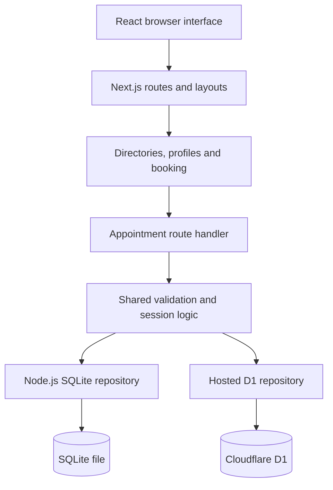

# Lumina Clinic: system architecture

## Implemented scope
A React 19 / Next.js App Router application with five primary pages, three doctor detail URLs, English, Simplified Chinese, Spanish and Arabic translations, persistent light/dark preferences, and database-backed demo appointments.

| Route | Implemented behavior |
| --- | --- |
| `/` | Clinic introduction, service links, doctor cards, booking entry points |
| `/doctors` | Search by translated name or specialty; clickable images and profiles |
| `/doctors/sarah-mitchell` | Full illustrative general physician profile |
| `/doctors/james-wilson` | Full illustrative cardiologist profile |
| `/doctors/emily-chen` | Full illustrative dermatologist profile |
| `/services` | Six translated service cards linked to booking |
| `/book` | Service, doctor, date, time, name, email, consent; server confirmation |
| `/appointments` | Load server records, inspect visits, cancel with confirmation, retry errors |
| `/api/appointments` | GET, POST and DELETE HTTP API |

Doctor profiles include an introduction, illustrative experience and education, languages, clinical interests and consultation information. All people and qualifications are clearly labeled as demo content. A booking never reserves a real clinic visit and sends no email.

## Architecture


The same application has two supported runtimes:

1. Standard Next.js on Node.js uses `lib/appointment-repository.ts`, which loads `server/repository.mjs`. The SQLite file lives at `server/data/clinic.sqlite`, or in `DATA_DIR` when configured. Use a durable volume when hosting this Node version. SQLite is not suitable on an ephemeral serverless filesystem.
2. The private Sites deployment uses the Next.js-compatible Vinext runtime on Cloudflare Workers. A pre-build source transform resolves the API route repository import to `lib/d1-repository.ts`. A bundle assertion rejects Node SQLite in the hosted output. A declared D1 binding provides persistent hosted records. It does not run a Node.js process.

An additional standalone Node HTTP server exposes the same API on port 4000. It shares the business logic, validation, and SQLite repository. It is optional: standard Next.js already serves the API itself on the frontend origin.

## Source organization
```text
app/
  layout.tsx                    Global metadata and Preferences provider
  page.tsx                      Home
  doctors/page.tsx              Doctor directory
  doctors/[id]/page.tsx         Validated dynamic profile route
  services/page.tsx             Service directory
  book/page.tsx                 Booking route
  appointments/page.tsx         Appointment management
  api/appointments/route.ts     Same-origin API adapter
  not-found.tsx                 Multilingual missing-page response
  globals.css                  Glass surfaces, layout, themes, RTL
components/
  clinic.tsx                    Shared shell and clinic views
  preferences.tsx               Locale/theme state and controls
  language-menu.tsx             Accessible animated language disclosure
  hero-dithering.tsx            Decorative theme-aware dither canvas
  halo-hover.tsx                Delegated pointer/focus halo material
  clinic-footer.tsx             Translated responsive footer and booking CTA
  logo-mark.tsx                 Shared scalable 3D-style brand symbol
lib/
  clinic-data.ts                Stable doctor/service IDs and types
  messages.ts                   Four complete translation dictionaries
  appointment-repository.ts     Standard Node repository entry
  d1-repository.ts              Hosted repository adapter
server/
  appointment-api.mjs            Runtime-independent request handler
  repository.mjs                Node SQLite persistence
  index.mjs                     Standalone Node HTTP server
  appointment-api.test.mjs       HTTP integration and persistence tests
db/schema.ts                    Drizzle hosted schema
Drizzle migrations              Committed schema SQL and metadata
public/architecture.md          Downloadable architecture file
public/design-system.md         Downloadable design specification
```

## Appointment model
| Field | Purpose |
| --- | --- |
| `id` | Server-generated UUID |
| `owner` | SHA-256 hash of private random browser session token |
| `name`, `email` | Sample patient details |
| `doctor`, `service` | Allowlisted stable IDs, independent of UI language |
| `date`, `time` | Clinic-local schedule in Asia/Karachi, displayed with PKT |
| `created_at` | UTC ISO creation timestamp |

A database unique index on `(doctor, date, time)` prevents duplicate bookings, including requests from separate sessions. Cancellation deletes the record and frees the slot. This demo does not retain a clinical or audit history.

## API contract
| Operation | Request | Result |
| --- | --- | --- |
| List | `GET /api/appointments` | 200 with `{ appointments: [...] }` for current session |
| Book | `POST /api/appointments` | 201 with `{ appointment: ... }` |
| Cancel | `DELETE /api/appointments?id=<uuid>` | 200 `{ ok: true }`, or 404 for missing/unowned visit |
| Health | `GET /api/health` on standalone Node server | Runtime/storage health response |

POST JSON fields: `name`, `email`, `doctor`, `service`, `date`, `time`. Required fields are validated on both form and server. The server enforces length limits, a basic email check, allowlisted doctor/service/time IDs, valid calendar dates, no past dates/times, weekdays only, and a one-year booking horizon. Clinic time is Asia/Karachi. Each session can hold up to 20 demo visits. The UI offers all schedule options and reports a conflict if a slot was claimed; it does not implement live slot inventory.

Status codes: 400 invalid JSON/ID; 403 rejected origin; 404 missing/unowned appointment; 405 unsupported method; 409 occupied slot; 413 oversized body; 422 invalid input; 429 visit limit; 503 unavailable storage. The UI translates actionable error categories rather than displaying English-only server messages.

## Session and data boundaries
The server issues a 256-bit random token in a `lumina_session` cookie. It is HttpOnly, SameSite=Lax, Secure over HTTPS, and expires after 30 days. Only a hash is stored with records. Listing and deletion always filter by the owner hash. Cross-origin writes with a mismatched Origin header are rejected. Responses use `Cache-Control: no-store`.

This is session ownership, not account authentication. Changing devices or clearing cookies prevents access to the prior session's records. The server records are not automatically deleted when a cookie expires. No cross-device identity, admin portal, patient medical record, payment, email notification, or retention automation is implemented. Existing records from the earlier localStorage-only version are not imported.

Before use with real patients, add authenticated accounts and staff roles, audit trails, privacy/retention controls, a robust slot inventory, rate limiting beyond the demo visit cap, email delivery, monitoring and operational backups. Do not collect medical histories in this demo.

## Localization and themes
`Preferences` is a top-level React context. All primary page text, form labels, service descriptions, profile content, success/error states, and navigation are keyed in `messages.ts`. Stable IDs are stored in the API, so changing a language does not change a booking's identity. Dates use `Intl.DateTimeFormat` in the selected locale.

The language dropdown provides English, 中文, Español and العربية. It sets the document `lang` and `dir`. Arabic uses RTL layout rules for panels, navigation, icons, profile links and appointment cards. Theme and locale are browser-local preferences, stored separately from server appointments. Dark mode initially follows the operating system when no preference is saved. An inline pre-paint script sets the saved theme and document direction before the first frame. A layout effect loads preferences before hydrated content paints. Standard anchor navigation loads each route directly instead of relying on the hosted client-router transport.

## Design system
See `DESIGN_SYSTEM.md` for color tokens, transparency, blur, type, spacing, hover, keyboard focus, mobile behavior and dark/RTL rules. The public copies of both documents are downloadable from the site footer.

## Development and deployment
Requires Node.js 22.13+; Node.js 24 was used for verification.

Standard Node/Next.js experience:
```bash
npm install
npm run dev:next
```
Open http://localhost:3000. The frontend and appointment API run together; SQLite is created automatically by the Node repository. For a production Node build:
```bash
npm run build:next
npm run start:next
```

Optional standalone Node API:
```bash
npm run backend
```
Default URL http://127.0.0.1:4000. Override `API_PORT` and `DATA_DIR` with environment variables. It binds to localhost by default. The React app uses same-origin `/api/appointments`; it does not automatically point to port 4000.

Sites workflow:
```bash
npm run dev
npm run build
```
The Sites runtime uses the D1 adapter and declared `DB` binding. Hosted schema changes are generated with `npm run db:generate`, inspected, committed, and applied during publication. Standard Next.js uses its own SQLite table initialization; it does not use hosted D1 migrations.

## Source package and layout release
The downloadable source package includes the current application, README, design system, this architecture document and release notes. Build output, dependencies, runtime SQLite data, credentials and Git history are omitted. Its hosting manifest is sanitized to avoid reusing the original Site identity. Standard Node/Next scripts run the complete app locally with SQLite; Sites uses the dedicated hosted repository transform.

Navbar card outlines were removed, text/label containers now shrink and wrap, and translated page headings/appointment details have responsive containment. See RELEASE_NOTES.md for the release scope and remaining visual QA limits.

## Verification
- Standard Next.js production build: all primary pages, dynamic doctor profile route and API compile.
- Sites/Vinext production build: hosted route bundle and D1 adapter compile.
- TypeScript checks.
- Node HTTP integration test: health, empty listing, HttpOnly session cookie, invalid email/date, cross-origin rejection, creation, duplicate-slot rejection, session isolation, unauthorized cancellation, persistence after server restart, authorized cancellation, final empty listing.
- Run tests: `node --test server/appointment-api.test.mjs`.
- Browser visual/interaction testing is unavailable in this environment. Mobile, RTL, theme and language behavior require a browser review before production use.

## Halo interaction implementation
A global client-only `HaloHover` component adds decorative data attributes to actionable elements and glass panels. Pointer movement is delegated and coalesced with requestAnimationFrame, keeping pointer position outside React state. The masked CSS ring cannot intercept clicks. Focus receives equivalent feedback, reduced-motion preferences disable pointer tracking, and touch is excluded from hover effects. A MutationObserver registers newly mounted booking/appointment states.

## Organic card interactions
Content cards share the `organic-card` CSS material. The existing HaloHover pointer loop also updates two bounded CSS rotation variables for organic cards. No additional per-card event listeners or React render loops are introduced. Forms do not tilt; reduced-motion users receive static shapes. See the design-system document for shape, image and touch behavior.

## Brand assets
`public/lumina-logo-3d.svg` is a project-native extension of the existing medical-cross mark. It is reused through `LogoMark`, with no image-generation API, external asset request or 3D runtime dependency. The shared footer supports each language and links directly to the existing booking, directory, appointment, maps and document destinations.

## External assets
Representative images are loaded from direct Unsplash URLs. The hero photo is https://unsplash.com/photos/doctor-consults-with-patient-in-medical-office-iyeUwItlIPk . Google Fonts supplies Manrope and DM Sans; Arabic/Chinese use system fallback fonts when these families do not contain the needed glyphs. Google Maps opens a general nearby-clinic search, not a real clinic address. Fonts and photos require network access.
